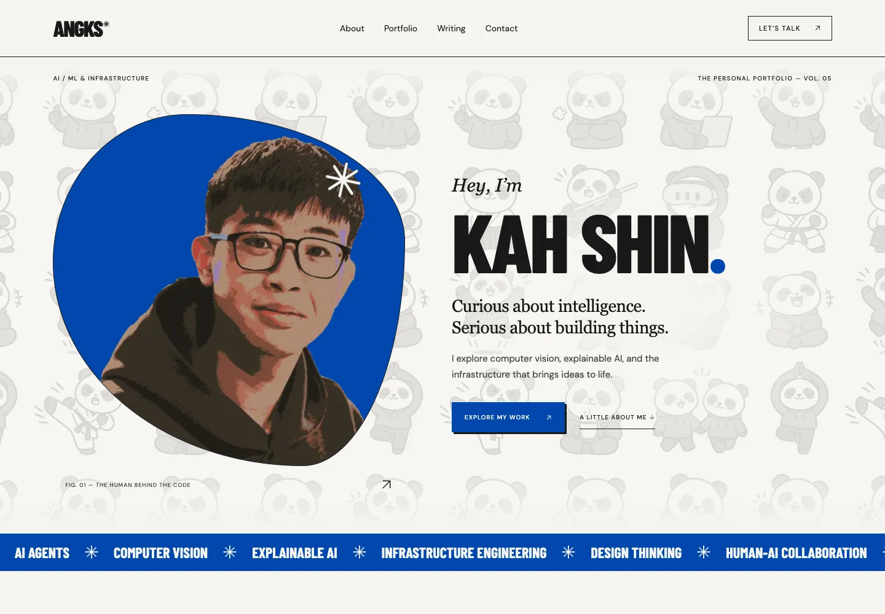
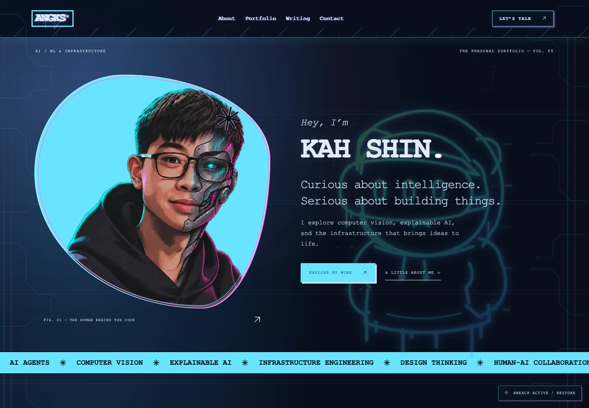
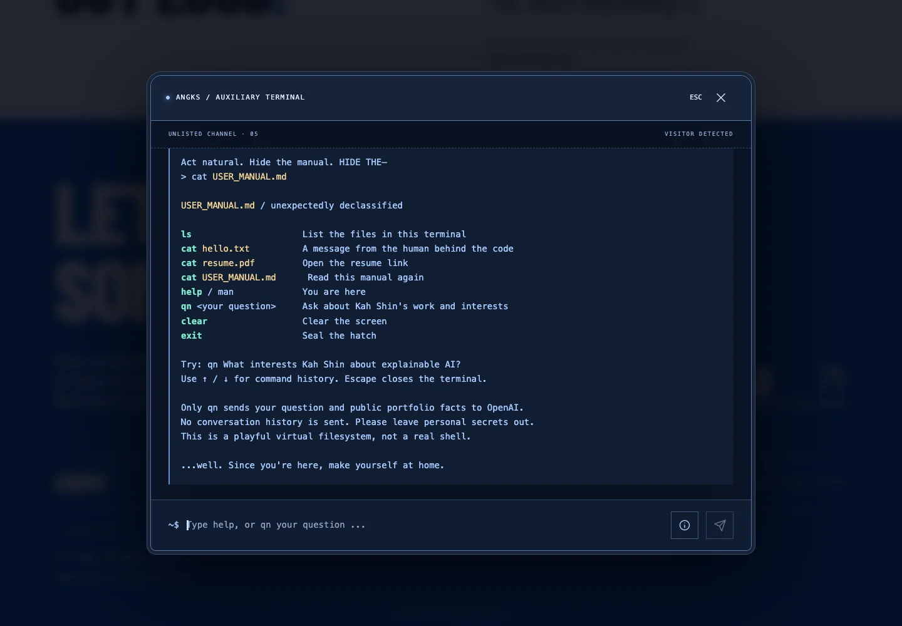
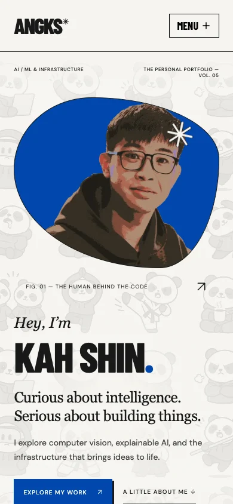

# V5 — Kah Shin’s portfolio

A comic-inspired personal portfolio with a second, cyberpunk side hiding beneath the page. Built with Next.js, TypeScript, Motion, and Vercel.

**[Visit the live portfolio](https://kahshin-portfolio-v5.vercel.app)** · [Report an issue](https://github.com/AngKS/V5/issues)

## Screenshots

### The comic side

Bold typography, cobalt accents, panda artwork, and an organic portrait frame.



### The other side

Discover the auxiliary terminal to unlock neon circuitry, Matrix rain, and a cybernetic portrait. Restore the original page through a full-screen monochrome comic sequence with rapid cuts, extreme zooms, and a 3D page flip.



### Auxiliary terminal

A virtual filesystem and optional AI-powered Q&A about Kah Shin’s public portfolio facts.



### Mobile

Responsive navigation, a resume shortcut, swipeable projects, and a fullscreen terminal.



Screenshots capture the local application; animated effects are best experienced on the live site.

## Features

- Responsive introduction, LinkedIn experience link, project carousel, writing section, and contact links.
- GitHub projects ranked by stars, then latest default-branch commit; lazy loading, pagination, touch swipes, and horizontal trackpad navigation.
- Medium RSS integration, with a coming-soon state until a profile is configured.
- Animated panda introduction and a page-corner reveal of a skills factory in normal mode.
- An elastic footer pull that reveals a terminal with a typed boot sequence, command history, and highlighted responses.
- Breach mode with neon panda stencils, circuit traces, a cybernetic portrait, chromatic glitches, and section-level Matrix rain.
- A discovery passport saved locally in the visitor’s browser. The collected “Other side” stamp can replay the breach transition.
- Comic loading animation, custom “Object not detected” 404, and an engine-room link to this repository.
- Reduced-motion support, keyboard controls, and SVG icons.

## Stack

Next.js App Router · React · TypeScript · Motion for React · Vercel AI SDK · OpenAI · Vercel Blob

## Run locally

Use Node.js 20.9 or newer.

```sh
git clone https://github.com/AngKS/V5.git
cd V5
npm ci
cp .env.example .env.local
npm run dev
```

Open [localhost:3005](http://localhost:3005). The portfolio and local terminal commands work without an OpenAI key.

```sh
npm run typecheck
npm test
npm run build
```

## Make it your own

Replace the personal content and artwork before publishing your own portfolio.

| Location                             | Purpose                                                 |
| ------------------------------------ | ------------------------------------------------------- |
| `src/content/profile.ts`             | Contact details, social links, and verified experience  |
| `src/content/terminal-knowledge.ts`  | Public facts used by Q&A                                |
| `src/lib/files.ts`                   | Resume fallback and public file handling                |
| `src/components/header.tsx`          | Navigation and mobile resume shortcut                   |
| `src/components/mode-transition.tsx` | Comic cut-scenes and mode transitions                   |
| `public/`                            | Portraits, comic illustrations, and other visual assets |
| `src/app/globals.css`                | Base colors, typography, and responsive layout          |

Experience links to LinkedIn until verified entries are supplied. No automatic LinkedIn employment-history sync is implemented.

### Environment variables

All credentials stay server-side. Never prefix secret keys with `NEXT_PUBLIC_` or commit `.env.local`.

| Variable                | Purpose                                                                       |
| ----------------------- | ----------------------------------------------------------------------------- |
| `GITHUB_TOKEN`          | Optional higher rate limit for GitHub metadata                                |
| `MEDIUM_PROFILE_URL`    | Optional Medium profile for article previews                                  |
| `OPENAI_API_KEY`        | Enables terminal Q&A                                                          |
| `OPENAI_MODEL`          | Selects the OpenAI model; review provider availability and pricing before use |
| `BLOB_READ_WRITE_TOKEN` | Owner-only script credential for uploading public portfolio files             |
| `PORTFOLIO_BLOB_URL`    | Public Blob store origin                                                      |

See [`.env.example`](.env.example) for the configured defaults. GitHub metadata and Medium feeds are cached for one hour. Unavailable commit dates fall back to repository push dates and are labeled in the interface.

## Terminal and discoveries

Keep scrolling past the footer to pull up the terminal, or use the “END OF TRANSMISSION” button. Escape, the close button, or `exit` closes it and enters breach mode. Restore returns to the original page; both mode transitions return the viewport to the top.

```text
ls                    List available files
cat hello.txt         A message from the human behind the code
cat USER_MANUAL.md     Read the terminal manual
cat resume.pdf        Open the resume
help / man            Show instructions
qn <question>         Ask about Kah Shin’s public work and interests
clear                 Clear the output
exit                  Close the terminal
```

This is a virtual filesystem, not a shell. Only `qn` sends a question and curated public facts to OpenAI. No conversation history is sent, no AI tools are enabled, and provider response storage is disabled. AI answers may be imperfect. The info button beside the command input explains this disclosure.

Questions are capped at 600 characters, responses at 1,200 output tokens (including reasoning), with a 25-second timeout and no automatic retries. The API rejects cross-origin browser requests and oversized bodies. Its 20-request/minute per-instance limiter is not a distributed spending cap; configure provider budgets and production rate limiting when enabling a paid key.

Discovery stamps use `v5:discovery-stamps:v1` in localStorage; breach state uses sessionStorage. Neither is sent to the server. Section rain pauses offscreen and while the tab is hidden. Reduced motion bypasses cinematic transitions and disables animated rain.

## Portfolio files

Connect a **public** Vercel Blob store for visitor-facing files. There is no public upload endpoint.

```sh
npm run files:upload -- /absolute/path/resume.pdf
# Deliberately replace previously published files:
npm run files:upload -- /absolute/path/resume.pdf --overwrite
```

The script uploads `portfolio/resume.pdf`, `portfolio/USER_MANUAL.md`, and `portfolio/hello.txt`. Without a PDF argument, it uploads only the text files. Set `PORTFOLIO_BLOB_URL` to the printed store origin and restart or redeploy.

The `/files/resume.pdf` route falls back to the Google Drive resume when the Blob PDF is unavailable. The mobile menu links directly to Google Drive. Text files have bundled fallbacks. Uploaded files do not automatically become AI knowledge.

## Deployment

The repository’s `main` branch is connected to the Vercel project `kahshin-portfolio-v5`; pushes trigger production deployments. For your own fork, import it into Vercel, select the Next.js preset, and configure environment variables in your own project. No custom `vercel.json` is required.

## AI agent access

The homepage registers six read-only tools when the experimental
`document.modelContext` WebMCP API is available:

- `get_portfolio_profile`: owner-supplied biography and interests.
- `get_portfolio_experience`: career entries, LinkedIn source and review date.
- `get_portfolio_education`: study programmes, dates and activities; future completion is explicitly marked.
- `get_portfolio_contact`: public contact, resume, and source links.
- `get_portfolio_writing`: public article metadata or availability status.
- `list_portfolio_projects`: paginated public GitHub repositories (`page`, zero-based).

No tools call OpenAI, send messages, navigate the page, mutate data, or access
visitor storage. External repository/feed content is marked untrusted. Tools
register only on the homepage, clean up via AbortSignal, and are a no-op in
unsupported browsers. Native availability depends on browser support and policy.

For agents without WebMCP, `/llms.txt` links to `/api/agent`, its public JSON
resources, and the existing project API. These are HTTP resources, not a remote
MCP server. `src/content/agent-info.ts` holds the public facts; it never exports
internal terminal instructions. LinkedIn career and education are a manually reviewed snapshot (2026-11-03), not an automatic sync. Missing details and resume text are explicitly
marked as unavailable. Optional feeds retain the site's one-hour cache behavior.

## Contributing

Issues and pull requests are welcome. For changes, run `npm run typecheck`, `npm test`, and `npm run build`. Check responsive layouts, keyboard navigation, and reduced-motion behavior when changing interactive features. Keep credentials and private information out of contributions.

## License and credits

The source code is available under the [MIT License](LICENSE). You may use, modify, and redistribute it under those terms.

Personal photos, portraits, panda artwork, generated comic illustrations, logos, resume content, and screenshots are **not included in the MIT license**. They are shown here to document this portfolio; replace them with assets you have permission to use. See [NOTICE.md](NOTICE.md).

Visual inspiration: [Local Studio](https://localstudio.fr/about). The original panda outline was carried forward from Kah Shin’s earlier portfolio. Comic illustrations were generated from supplied photographs.
